# Zamrożenie: lifesteal, bossy i legendarne przedmioty na serwer Minecraft

To mój plugin na serwer SMP z PvP (Paper 1.21.11). Ma lifesteal, 12 przedmiotów z własnymi umiejętnościami (miecz, który ładuje się przy trafieniach i strzela falą dźwiękową, łuk robiący czarną dziurę, kilof niszczący 3×3), codzienny zrzut ze skrzynią, event Smoka Kresu, bossa z MythicMobs, sklep z cenami, które reagują na sprzedaż, rynek graczy, klany i własnego anticheata.

Plugin jest w Javie: 139 plików i około 19 tys. linii. Niżej nagrania z mojego serwera testowego, a dalej opis przedmiotów i systemów.

## Jak to wygląda

Nagrania z serwera testowego (Paper 1.21.11). Każde jest też jako MP4 w pełniejszej jakości (link pod obrazkiem), bez dźwięku.

| | |
|---|---|
| 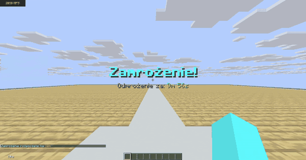 `/zamrozenie 10m`: tytuł z odliczaniem, moby i gracze stoją w miejscu. [MP4](docs/media/clips/zamrozenie.mp4) | 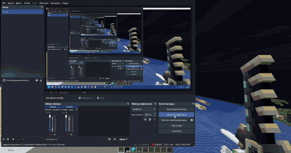 Warden Sword: po naładowaniu do 100% Shift + PPM wystrzeliwuje Sonic Boom. [MP4](docs/media/clips/warden-sonic-boom.mp4) |
| 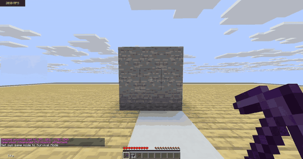 Kilof Otchłani: wykop z płomieniami, lawą i dropem. [MP4](docs/media/clips/kilof-otchlani.mp4) | 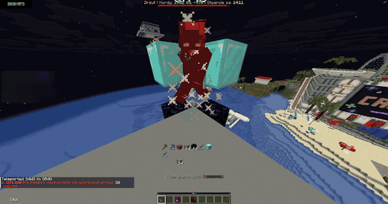 Smoczy Szpon: pasek obrażeń rośnie do 150% z każdym trafieniem. [MP4](docs/media/clips/smoczy-szpon.mp4) |
| 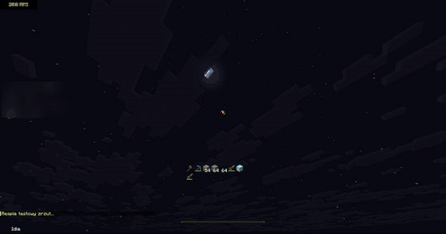 Zrzut: tytuł „Zrzut spadł!”, bossbar z odliczaniem i skrzynia lądująca na wodzie. [MP4](docs/media/clips/zrzut.mp4) | 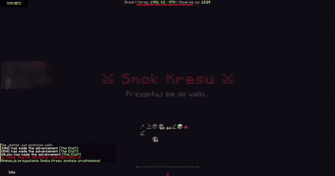 Event Smoka Kresu: animacja przywołania i start walki. [MP4](docs/media/clips/smok-kresu.mp4) |

Okna w grze (tła z paczki zasobów serwera, przedmioty i opisy dokłada plugin):

| | | |
|---|---|---|
| 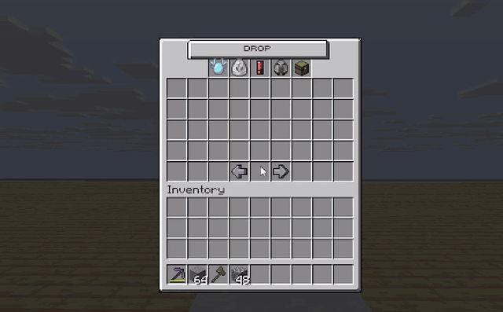 `/drop`: pule dropu bossów. [MP4](docs/media/clips/drop-gui.mp4) | 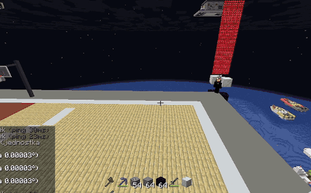 `/rynek`: kategorie, filtrowanie i wyszukiwanie. [MP4](docs/media/clips/rynek-gui.mp4) | 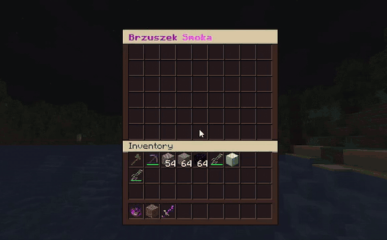 Brzuszek Smoka: okno 54 slotów. [MP4](docs/media/clips/brzuszek-gui.mp4) |

### Schematy

Dla dwóch przedmiotów nie mam jeszcze nagrań z gry, więc zrobiłem animacje z prawdziwych tekstur Minecrafta i liczb z kodu (zasięgi, czasy, wzory ruchu). Nie mają dźwięku ani prawdziwych cząsteczek, a ruch graczy jest przybliżony.

| | |
|---|---|
| 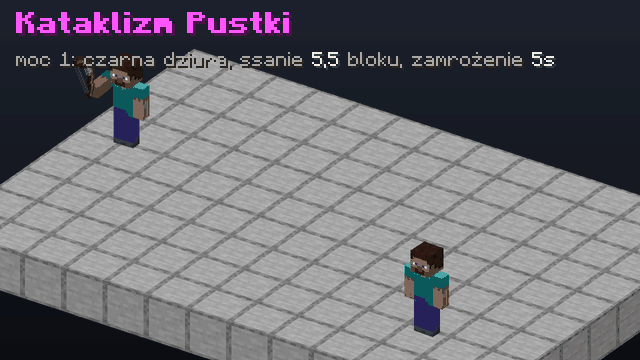 Kataklizm Pustki: strzała otwiera czarną dziurę, która wciąga graczy w promieniu 5,5 bloku i zamraża tych, którzy się zbliżą | 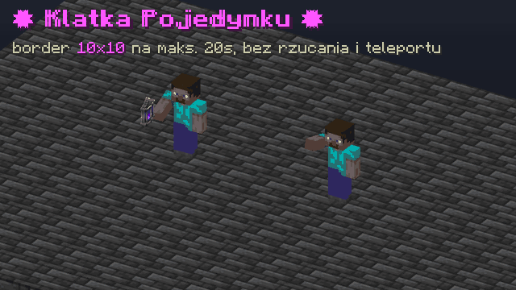 Klatka Pojedynku: border 10×10 wokół dwóch graczy na maks. 20 s |

Schematy pozostałych przedmiotów (Warden Sword, kilof, Smoczy Szpon) są w [docs/ITEMY.md](docs/ITEMY.md).

## Przedmioty

Opis każdego (liczby z kodu, jak zdobyć, komenda) jest w [docs/ITEMY.md](docs/ITEMY.md). Tooltipy są narysowane czcionką z gry i mają dokładnie ten tekst, który generuje plugin.

| | Przedmiot | Co robi |
|---|---|---|
| 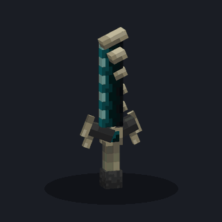 | [**Warden Sword**](docs/ITEMY.md#warden-sword) | ładuje się trafieniami, przy 100% Sonic Boom: 5 serc true damage na 24 bloki |
| 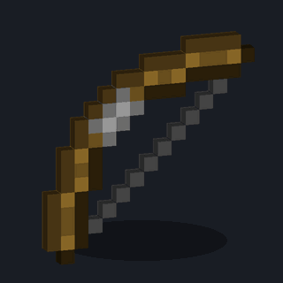 | [**Kataklizm Pustki**](docs/ITEMY.md#kataklizm-pustki) | łuk z dwiema mocami: czarna dziura (ssanie 5,5 bloku, zamrożenie 5 s) albo strzała za 3,5 serca. Cooldown 2,5 min |
| 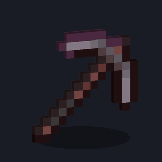 | [**Kilof Otchłani**](docs/ITEMY.md#kilof-otchłani-i-odłamek-kilofa) | kopie 3×3, w walce działa jak zwykły kilof. Craft z dwóch serc, Heavy Core, jabłek, 64 diamentów i odłamka |
| 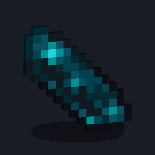 | [**Odłamek Kilofa**](docs/ITEMY.md#kilof-otchłani-i-odłamek-kilofa) | składnik craftingu kilofa (zwykły Echo Shard nie zadziała) |
| 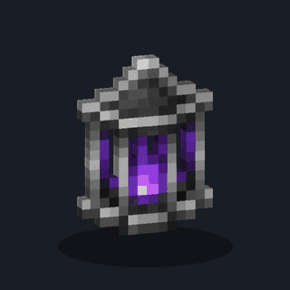 | [**Klatka Pojedynku**](docs/ITEMY.md#klatka-pojedynku) | trafiony gracz i ty lądujecie w borderze 10×10 na 20 s. Cooldown 90 s |
| 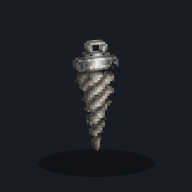 | [**Kolce Rozdarcia**](docs/ITEMY.md#kolce-rozdarcia) | trafienie nakłada Osłabienie I na 10 s i Spowolnienie II na 3 s |
| 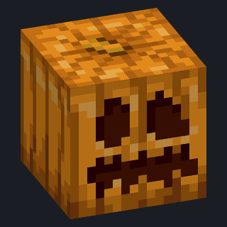 | [**Dynia Bossa**](docs/ITEMY.md#dynia-bossa) | hełm: Odporność I i ukryte Protection VII, nieniszczalny |
| 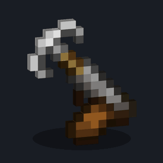 | [**Hak Pustkowi**](docs/ITEMY.md#hak-pustkowi) | wędka, która wyrzuca gracza w stronę haka, bez obrażeń z upadku. Cooldown 4 s |
| 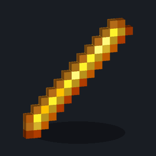 | [**Berło Furii**](docs/ITEMY.md#berło-furii) | PPM: Siła III i Szybkość III na 5 s. Cooldown 40 s |
| 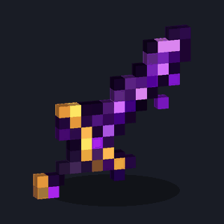 | [**Smoczy Szpon**](docs/ITEMY.md#smoczy-szpon) | z eventu Smoka Kresu: obrażenia rosną o 5% z każdym trafieniem, max 150% |
| 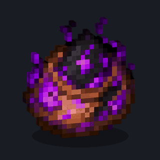 | [**Brzuszek Smoka**](docs/ITEMY.md#brzuszek-smoka) | po zabiciu gracza jego ekwipunek ląduje w brzuszku (okno 54 slotów) |
|  | [**Serce**](docs/ITEMY.md#serce-lifesteal) | PPM: +1 serce do maksymalnego HP, limit 20 |

## Co to jest?

Plugin na serwer SMP z PvP, w którym liczą się serca (lifesteal), eventy i legendarne przedmioty. Nazwa pochodzi od pierwszej funkcji: `/zamrozenie <czas>` zamraża na pewien czas moby i graczy.

* **Lifesteal.** Start z 10 sercami, maksimum 20. Śmierć zabiera serce, zabójca dostaje je. Anty-multikonto: ta sama para graczy albo IP raz na 30 minut. Po śmierci 180 s ochrony, na 0 serc ban, który cofa Księga Odrodzenia. [Więcej](docs/SYSTEMY.md#lifesteal)
* **Zrzut.** Codziennie o ustawionej godzinie z nieba spada skrzynia (animacja w spectatorze), potem 15 minut blokady z bossbarem i trzy zagadki. Skrzynię zabiera, kto pierwszy je rozwiąże. [Więcej](docs/SYSTEMY.md#zrzut)
* **Event Smoka Kresu.** Animacja przywołania (12 s), plugin sam liczy obrażenia do 1500 HP i rozdaje nagrody: 4 losowe przedmioty i jedną eventówkę. [Więcej](docs/SYSTEMY.md#event-smoka-kresu)
* **Władca Lochów.** Boss z MythicMobs i modelem z ModelEngine (3000 HP, ataki obszarowe, przyzywanie strażników) z bossbarem, tablicą TOP 3 obrażeń i dropem dla TOP 1. [Więcej](docs/SYSTEMY.md#władca-lochów-i-drop)
* **Sklep i rynek.** Sklep skupuje i sprzedaje, a cena spada o 0,01$ za każde 250$ sprzedaży i wraca po bezczynności. Przy dużym zarobku z jednego itemu cena spada o 40% tylko dla tego gracza. Rynek graczy ma kategorie, sortowanie i tabliczki. [Więcej](docs/SYSTEMY.md#sklep-i-rynek)
* **Klany.** Do 4 osób, rangi, sojusze, czat, kolorowy tag na czacie, nad głową i w tabie. [Więcej](docs/SYSTEMY.md#klany)
* **Walka i zasady PvP.** Tag walki 30 s, wylog w walce to śmierć, limity totemów, wyłączone perły i kryształy endu, zamknięty Nether, cooldowny na maca i włócznię. [Więcej](docs/SYSTEMY.md#walka-antylogout-i-zasady-pvp)
* **AntiCheat.** 16 checków (Reach, KillAura, Fly, Speed, Nuker i inne), domyślnie tylko alerty, plus automatyczne włączenie anti-xray w Paper. [Więcej](docs/SYSTEMY.md#anticheat-i-anti-xray)
* **Na co dzień:** `/home` z dwoma slotami, `/tpa`, `/topki`, poradnik w GUI (`/tutorial`), pasek lokatora widoczny w promieniu 100 kratek, placeholder `%zamrozenie_money%`.

Okna sklepu, rynku i dropu mają własne tła z paczki zasobów:

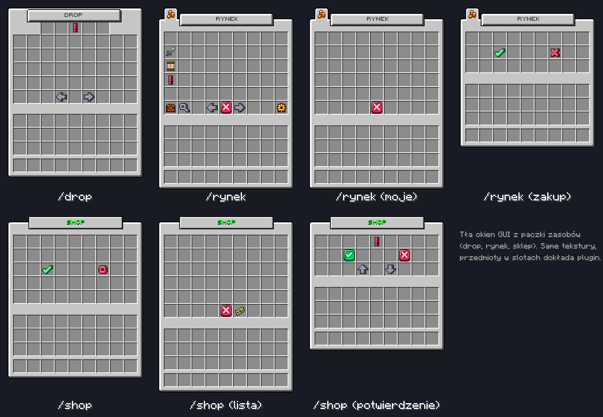

## Jak to jest zrobione

Więcej jest w [docs/ARCHITEKTURA.md](docs/ARCHITEKTURA.md), a tutaj najważniejsze rzeczy:

* przedmioty rozpoznaje się po NBT (`PersistentDataContainer`), nie po nazwie, więc zmiana nazwy w kowadle nic nie psuje, a paczka zasobów podpina modele po `CustomModelData`
* stan przedmiotu siedzi w samym przedmiocie: ładunek Warden Sword i tryb Kataklizmu Pustki przechodzą z graczem do skrzyni i z powrotem
* czarna dziura jest zbudowana z `BlockDisplay` i cząsteczek pyłu, bez własnych modeli, a wciąganie graczy jest liczone co tick
* okna GUI to osobne klasy `InventoryHolder`, więc klik w cudzy ekwipunek nie jest mylony z oknem pluginu
* klany i anticheat są osobnymi podsystemami (pakiety `clans` i `anticheat`), a anticheat dzieli się na checki z wagą naruszeń, które zanikają w czasie
* MythicMobs i PlaceholderAPI są opcjonalne (`softdepend`), więc plugin startuje bez nich
* dane trzymane są w plikach YAML w `plugins/Zamrozenie/`

## Autorzy

fr0zenowy & Claude Code
