# Przedmioty

Wszystkie przedmioty z własnymi umiejętnościami. Liczby (cooldowny, obrażenia, zasięgi) są wzięte z kodu, a teksty opisów są skopiowane 1:1 z `LegendaryItems.java` i `LifestealManager.java`. Tam, gdzie w kodzie nie ma polskich znaków, nie ma ich też na obrazkach.

Rodzaje obrazków w tym dokumencie:

* **nagrania z serwera testowego** (podpisane „nagranie”): wycięte z moich klipów, każde jest też jako MP4 bez dźwięku w [`media/clips/`](media/clips). Skrypt: [tools/clips/make_clips.py](../tools/clips/make_clips.py)
* **rendery przedmiotów i tooltipy**: modele i tekstury z paczki zasobów serwera i z klienta Minecrafta 1.21.11, a opisy są narysowane czcionką z gry
* **schematy** (podpisane „schemat”): animacje złożone z tych samych tekstur i liczb z kodu. To nie są nagrania, ruch graczy jest w nich przybliżony. Jak powstają, opisuje [tools/media/README.md](../tools/media/README.md)

| Przedmiot | Materiał | Jak zdobyć |
|---|---|---|
| [Warden Sword](#warden-sword) | `NETHERITE_SWORD` | eventówka, komenda dla OP |
| [Kataklizm Pustki](#kataklizm-pustki) | `BOW` | eventówka z bossa Władca Lochów |
| [Kilof Otchłani](#kilof-otchłani-i-odłamek-kilofa) | `NETHERITE_PICKAXE` | craft na stole 3×3 |
| [Odłamek Kilofa](#kilof-otchłani-i-odłamek-kilofa) | `ECHO_SHARD` | komenda dla OP |
| [Klatka Pojedynku](#klatka-pojedynku) | `GHAST_TEAR` | pula zrzutu |
| [Kolce Rozdarcia](#kolce-rozdarcia) | `PRISMARINE_SHARD` | pula zrzutu |
| [Dynia Bossa](#dynia-bossa) | `CARVED_PUMPKIN` | pula zrzutu |
| [Hak Pustkowi](#hak-pustkowi) | `FISHING_ROD` | komenda / eventy |
| [Berło Furii](#berło-furii) | `BLAZE_ROD` | komenda / eventy |
| [Smoczy Szpon](#smoczy-szpon) | `NETHERITE_SWORD` | event Smoka Kresu |
| [Brzuszek Smoka](#brzuszek-smoka) | `SHULKER_SHELL` | event Smoka Kresu |
| [Serce](#serce-lifesteal) | `RED_DYE` | zabójstwo, craft, `/wyplacserce` |

Każdy przedmiot ma w NBT swój identyfikator (`legendary_id` w `PersistentDataContainer`), więc działa niezależnie od nazwy i materiału. Modele w paczce zasobów są podpinane przez `CustomModelData` (5001–5007, 7100002, 7100003, 1001).

---

## Warden Sword

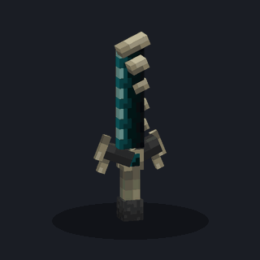 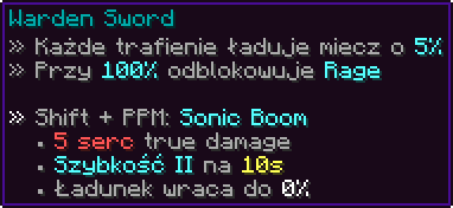

 

| | |
|---|---|
| Komenda | `/wardensword` (`zamrozenie.wardensword`, domyślnie OP) |
| Materiał | `NETHERITE_SWORD`, `CustomModelData` 7100002, własny model 3D (15 elementów, Blockbench) |
| Ładowanie | każde **pełnie naładowane** machnięcie (siła ataku ≥ 0,9), które trafia żywą istotę, daje **+5%**. Ładunek jest zapisany w samym mieczu |
| Rage | przy 100% miecz odblokowuje Sonic Boom (cząsteczka, dźwięk i wiadomość na czacie) |
| Sonic Boom | **Shift + PPM** przy 100%: promień o zasięgu **24 bloków** i szerokości 1,35, zatrzymuje się na pierwszym litym bloku |
| Obrażenia | **10 pkt (5 serc)** jako `DamageType.SONIC_BOOM` z atakującym jako sprawcą, więc zbroja ich nie zmniejsza |
| Po strzale | ładunek wraca do 0%, atakujący dostaje **Szybkość II na 10 s** |
| HUD | pasek ładunku na action barze, np. `⚡ 35% [|||-------]`. Nie jest pokazywany, gdy gracz ma tag walki |

**Nagranie: Sonic Boom** ([MP4](media/clips/warden-sonic-boom.mp4)). Fala dźwiękowa to prawdziwa cząsteczka `SONIC_BOOM`, więc z perspektywy strzelającego widać duże pierścienie.

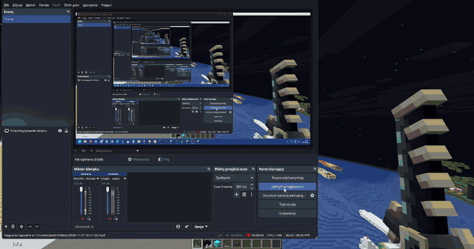

**Nagranie: trafienia** ([MP4](media/clips/warden-trafienia.mp4)). Zwykłe ataki ładują miecz, a przy uderzeniach widać efekty trafienia.

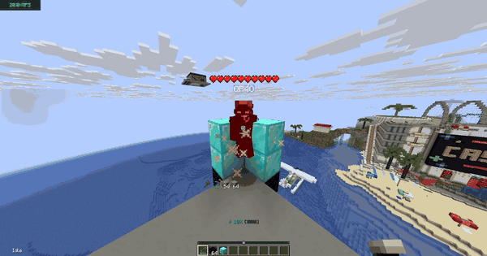

**Schemat:** dwadzieścia trafień po 5% do 100%, komunikat RAGE, Sonic Boom i spadek serc przeciwnika.

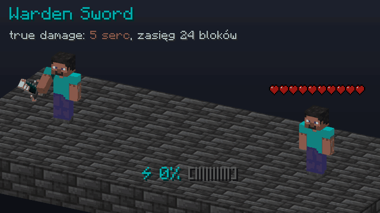

---

## Kataklizm Pustki

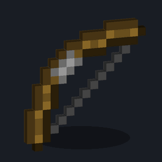 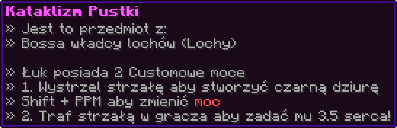

 

| | |
|---|---|
| Komenda | `/kataklizm` (aliasy `/voidbow`, `/kataklizmpustki`, `zamrozenie.kataklizm`) |
| Materiał | `BOW`, `CustomModelData` 7100003, przedmiot nieniszczalny |
| Zmiana mocy | **Shift + PPM**, wiadomość na action barze (`Moc: Czarna dziura` albo `Moc: 3.5 serca`) |
| Cooldown | **150 s (2 min 30 s)**, jeden wspólny dla obu mocy, liczony od strzału |

**Moc 1: czarna dziura.** Strzała jest zamieniana na niewidzialny `ShulkerBullet` (z grawitacją, maks. 100 ticków lotu). Po trafieniu w blok albo istotę otwiera się czarna dziura na **8 s**:

* wszyscy gracze w świecie w promieniu **5,5 bloku** (poza właścicielem łuku) są wciągani: co tick `prędkość = prędkość × 0,65 + kierunek × (0,18 + 0,32 × (1 − odległość/5,5))`
* kto zbliży się na **1,4 bloku**, jest **zamrożony na 5 s**: nie może się ruszyć, użyć perły, chorusa, spectatora ani elytry. Dostaje wiadomość „Czarna dziura Cię zamroziła na 5s!”
* wygląd zrobiony z `BlockDisplay`: rdzeń z czarnego betonu (1,7), czarne szkło (2,2), dwa pierścienie po 16 obracających się płytek (promienie 2,15 i 3,1) i pierścienie pyłu w kolorze pomarańczowym

**Moc 2: strzała 3,5 serca.** Strzała jest oznaczona, a trafienie gracza (nie siebie) anuluje zwykłe obrażenia i zadaje **7,0 pkt (3,5 serca)** jako `SONIC_BOOM`, z wyzerowanym czasem nietykalności.

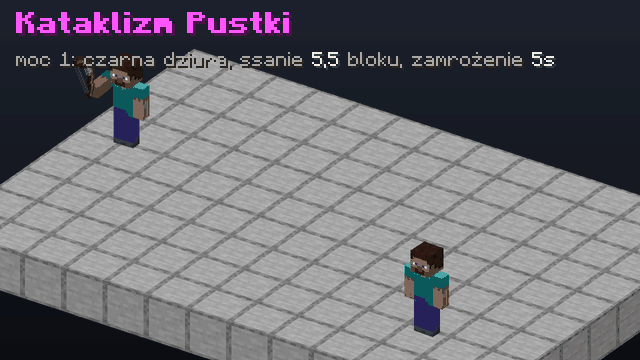

*Schemat (nie mam jeszcze nagrania z gry): strzał, otwarcie dziury, wciąganie i zamrożenie ofiary, 8-sekundowy czas dziury. Okręgi na podłodze to promienie 5,5 i 1,4 bloku. Pływające elementy mają rozmiary i prędkości z kodu `spawnHoleVisuals`.*

---

## Kilof Otchłani i Odłamek Kilofa

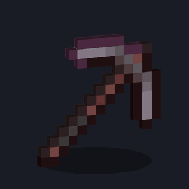 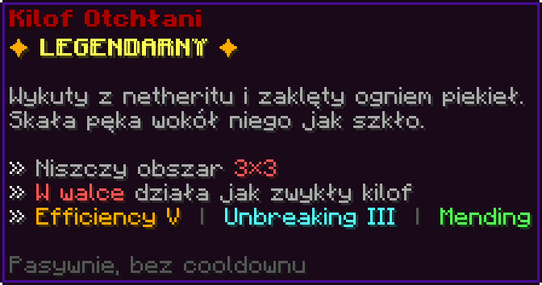

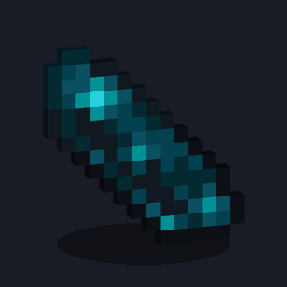 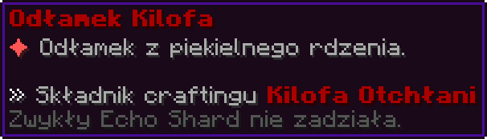

| | |
|---|---|
| Komendy | `/kilof3x3` (aliasy `/netherpick`, `/kilofotchlani`), `/odlamekkilofa` (aliasy `/odlamek`, `/pickshard`), obie `zamrozenie.kilof3x3` |
| Kilof | `NETHERITE_PICKAXE`, Efficiency V, Unbreaking III, Mending |
| 3×3 | po wykopaniu bloku niszczone jest jeszcze 8 sąsiednich w płaszczyźnie **prostopadłej do klikniętej ściany** (przy braku ściany kierunek wynika z pochylenia głowy) |
| Wytrzymałość | po całym wykopie zużycie jest cofane do wartości po **pierwszym** bloku, czyli kosztuje tyle co jeden blok |
| W walce | w tagu walki (`CombatTag` albo lifesteal) kilof działa jak zwykły |
| Wyjątki | bedrock, bariery, command blocki, structure blocki, portale, reinforced deepslate, light |
| Efekt | cząsteczki: soul fire, ogień, lawa, dym i crimson spore |

**Craft** (stół 3×3, każde pole musi mieć dokładną ilość):

| | | |
|---|---|---|
| Serce ×1 | Ciężki rdzeń (Heavy Core) ×1 | Serce ×1 |
| Złote jabłko ×5 | Diament ×64 | Zaklęte złote jabłko ×1 |
| *(puste)* | Odłamek Kilofa ×1 | *(puste)* |

Serca to przedmiot [Serce](#serce-lifesteal). Zwykły Echo Shard nie wystarczy, potrzebny jest Odłamek z oznaczeniem plugina.

**Nagranie: wykop** ([MP4](media/clips/kilof-otchlani.mp4)). Efekt po zniszczeniu bloku to soul fire, ogień, lawa, dym i crimson spore, a dookoła lecą dropy.

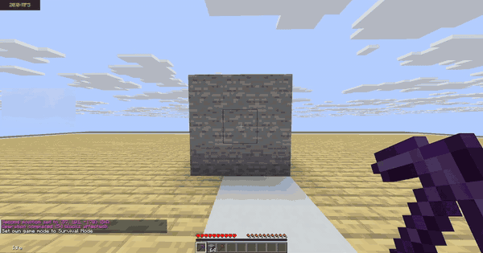

**Schemat:** pękanie środkowego bloku i wykop 3×3 (tekstury pęknięć `destroy_stage` są prawdziwe, cząsteczki uproszczone).

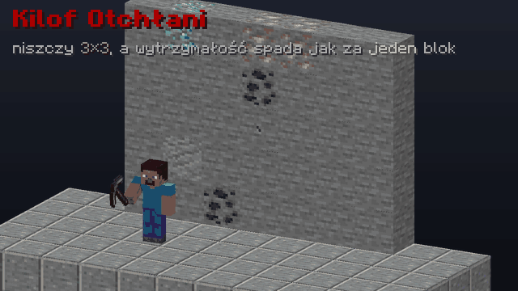

---

## Klatka Pojedynku

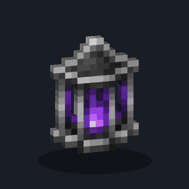 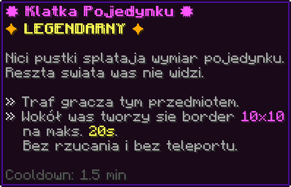

 

| | |
|---|---|
| Materiał | `GHAST_TEAR`, `CustomModelData` 5003, własna tekstura |
| Użycie | uderz gracza przedmiotem w ręce (LPM) |
| Efekt | wokół was powstaje **border 10×10** (indywidualny `WorldBorder` dla obu graczy, obrażenia przy wyjściu), na maks. **20 s**. Tytuł „Border!”, bossbar „ZNAJDUJESZ SIĘ W KLATCE!” z odliczaniem |
| Reszta świata | inni gracze są dla was ukryci (`refreshVisibility`), a wy dla nich |
| Koniec | śmierć, wyjście z gry albo upływ czasu (wtedy: „Czas klatki minął — wracacie na swoje miejsca.”) |
| Cooldown | **90 s** |

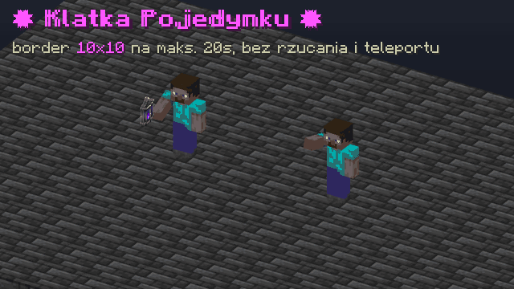

*Schemat (nie mam jeszcze nagrania z gry): uderzenie, cząsteczki portalu, border, bossbar z odliczaniem (przyspieszony x3) i koniec klatki.*

---

## Kolce Rozdarcia

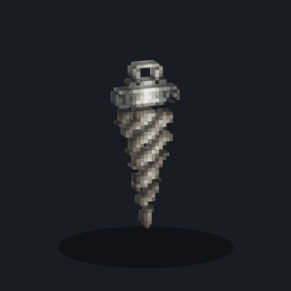 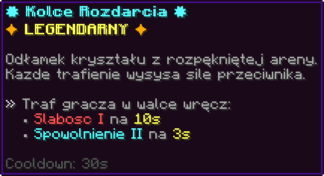

 

Trafienie gracza w walce wręcz nakłada na niego **Osłabienie I na 10 s** i **Spowolnienie II na 3 s** (cząsteczki krytyka i dźwięk). Cooldown **30 s**. `PRISMARINE_SHARD`, `CustomModelData` 5005.

---

## Dynia Bossa

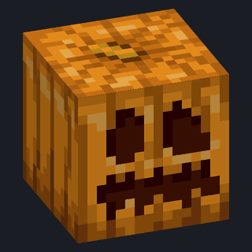 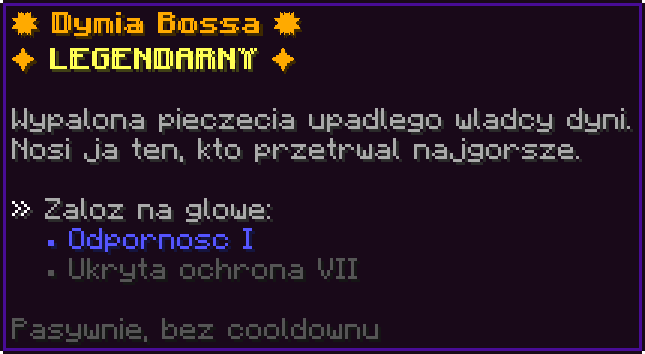

 

Hełm (`CARVED_PUMPKIN`, `CustomModelData` 5004), nieniszczalny, z ukrytym **Protection VII** i **Odpornością I** po założeniu (`LegendaryArmorListener`). Dynia nie ukrywa gracza na pasku lokatora, bo plugin zdejmuje modyfikatory zasięgu (`LocatorBarManager`).

> W paczce zasobów model `item/boss_pumpkin` jest już podpięty, ale pliku z teksturą jeszcze nie ma. Render powyżej pokazuje domyślną dynię z Minecrafta.

---

## Hak Pustkowi

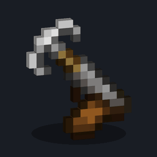 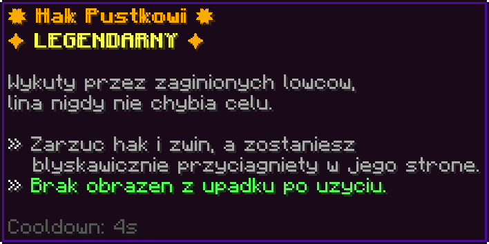

 

Wędka z własną teksturą (`CustomModelData` 5001). Po zarzuceniu i zwinięciu haka (stany: haczyk w ziemi, zwinięcie, nieudane łowienie, zahaczenie istoty) gracz dostaje prędkość w stronę haka:

* siła `min(odległość × 0,18 + 0,5; 2,2)`
* składowa pionowa `max(y + 0,2; 0,42)`
* haczyk bliżej niż 1,5 bloku nic nie robi
* **brak obrażeń z upadku przez 6 s**, cooldown **4 s**

---

## Berło Furii

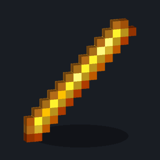 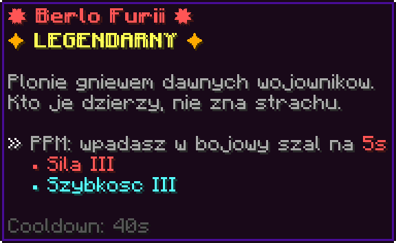

 

PPM: **Siła III i Szybkość III na 5 s**, płomienie i ryk ravagera. Cooldown **40 s** (dla materiału `BLAZE_ROD`). `CustomModelData` 5002.

> Model `item/fury` jest podpięty w paczce, ale tekstury `fury.png` jeszcze brakuje, więc render pokazuje zwykłą blaze rod.

---

## Smoczy Szpon

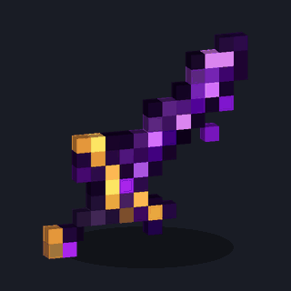 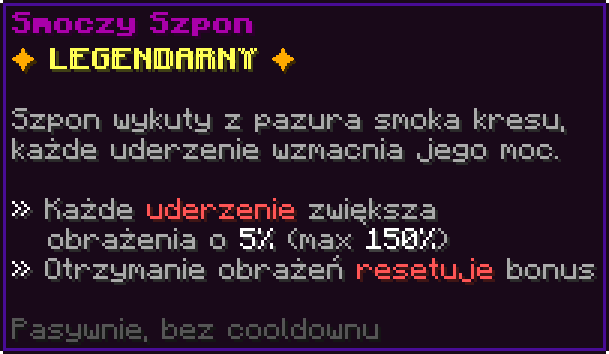

 

Nagroda z eventu Smoka Kresu (50/50 ze Brzuszkiem Smoka). `NETHERITE_SWORD`, Sharpness V i Unbreaking III (ukryte), `CustomModelData` 5007.

* działa tylko w **PvP**: każde trafienie gracza mnoży obrażenia przez aktualny bonus (start **100%**) i podnosi go o **5%**, do **150%**
* gdy właściciel **dostanie obrażenia od istoty**, bonus wraca do 100% (dym, popiół, wiadomość „Bonus Smoczego Szponu został zresetowany!”)
* action bar z paskiem bonusu (kolory: szary, złoty od 110%, czerwony od 130%, ciemnoczerwony od 150%), cząsteczki zaklęć rosną z bonusem, a przy 150% pojawia się oddech smoka

**Nagranie** ([MP4](media/clips/smoczy-szpon.mp4)): na action barze rośnie bonus obrażeń, a cząsteczki zaklęć gęstnieją.

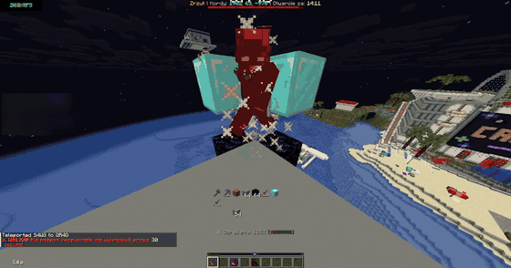

**Schemat:** jedenaście trafień od 100% do 150% i reset po otrzymaniu obrażeń.

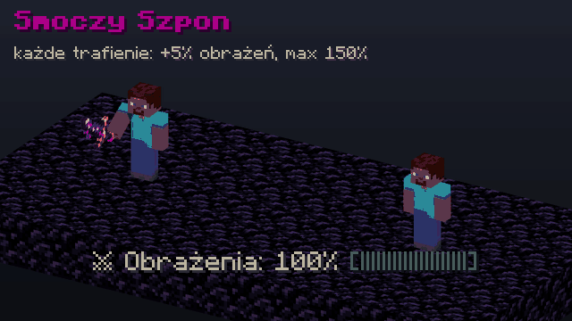

---

## Brzuszek Smoka

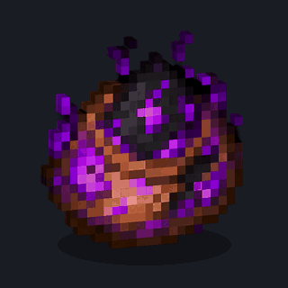 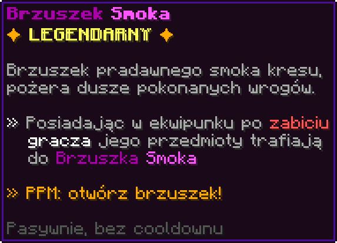

 

`SHULKER_SHELL`, `CustomModelData` 5006. Gdy gracz z Brzuszkiem w ekwipunku **zabije innego gracza**, cały jego ekwipunek i zbroja trafiają do brzuszka zamiast na ziemię (cząsteczki portalu, ryk smoka, wiadomość z liczbą przedmiotów).

**Nagranie: okno Brzuszka** ([MP4](media/clips/brzuszek-gui.mp4)).

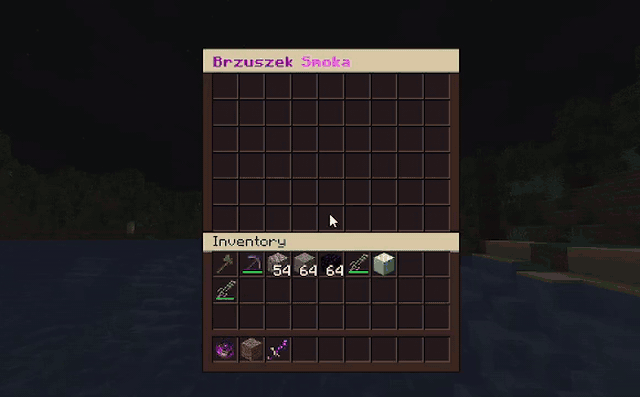

* PPM otwiera okno 54 slotów jak shulker, tylko jedna osoba naraz
* z okna można tylko **wyciągać** (wkładanie i shift-click z ekwipunku są zablokowane), a żeby wyciągać, trzeba mieć ten brzuszek w ekwipunku

> **Znane ograniczenie:** zawartość brzuszków trzymana jest wyłącznie w pamięci serwera (mapa po identyfikatorze brzuszka), bez zapisu na dysk. Po restarcie serwera zawartość znika.

---

## Serce (lifesteal)

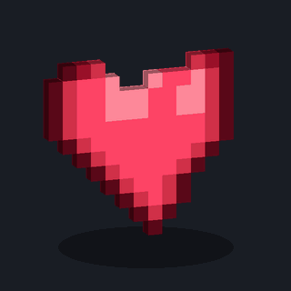 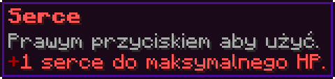

 

`RED_DYE`, `CustomModelData` 1001. PPM dodaje **1 serce do maksymalnego HP** (limit 20 serc). Craft w pluginie:

| | | |
|---|---|---|
| Blok złota | Blok złota | Blok złota |
| Blok diamentu | Gwiazda Netheru | Blok diamentu |
| Blok diamentu | Blok diamentu | Blok diamentu |

Zasady lifesteala opisane są w [SYSTEMY.md](SYSTEMY.md#lifesteal).
