# Systemy pluginu

Opis tego, co plugin robi poza przedmiotami (te są w [ITEMY.md](ITEMY.md)). Wszystko jest wzięte z kodu i z `config.yml`, a karty zrobiłem czcionką z gry.

* [Lifesteal](#lifesteal)
* [Zrzut](#zrzut)
* [Event Smoka Kresu](#event-smoka-kresu)
* [Władca Lochów i drop](#władca-lochów-i-drop)
* [Sklep i rynek](#sklep-i-rynek)
* [Klany](#klany)
* [Walka, antylogout i zasady PvP](#walka-antylogout-i-zasady-pvp)
* [AntiCheat i anti-xray](#anticheat-i-anti-xray)
* [Drobne systemy](#drobne-systemy)

---

## Lifesteal

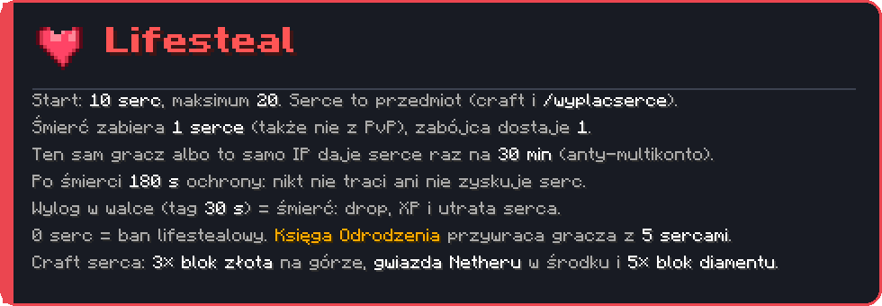

Najważniejsze liczby: **10 serc na start, maksimum 20**, śmierć zabiera 1, zabójca dostaje 1. Żeby nie dało się farmić serc na drugim koncie, ta sama para zabójca–ofiara (albo ten sam adres IP) daje serce raz na **30 minut**. Po śmierci gracz ma **180 s** ochrony (config `lifesteal.spawn-protection-seconds`).

Gracz z 0 serc dostaje ban lifestealowy (nie ban serwerowy). Przywraca go **Księga Odrodzenia**, która otwiera listę zbanowanych graczy, a odrodzony wraca z 5 sercami.

Komendy administracyjne: `/lifesteal info|set|add|take|reset potwierdz|give <gracz> heart|book`. Dla graczy: `/lifesteal` (swoje serca) i `/wyplacserce` (zamienia serce na przedmiot, wymaga potwierdzenia w ciągu 30 s).

---

## Zrzut

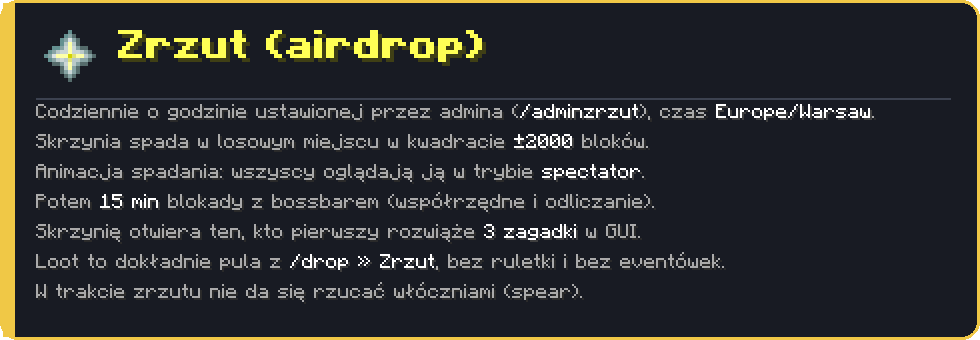

**Nagranie z serwera testowego** ([MP4](media/clips/zrzut.mp4)): iskry spadającej skrzyni, tytuł „Zrzut spadł!” z koordynatami, bossbar z odliczaniem do otwarcia i skrzynia na wodzie.

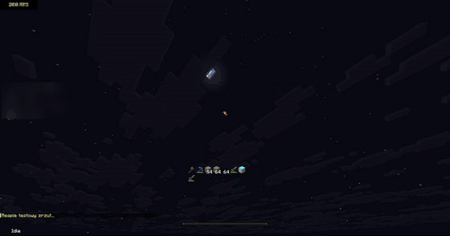

Fazy w kodzie (`ZrzutManager.Phase`): `IDLE` → `ANIMATION` → `LOCKED` → `OPEN`. W fazie animacji wszyscy gracze są przełączani na spectatora i oglądają spadającą skrzynię, a ich stan (miejsce, tryb gry, latanie) jest zapisywany i przywracany. Faza blokady trwa 15 minut z bossbarem, potem w GUI pojawiają się trzy zagadki (`ZrzutPuzzleHolder`), a skrzynię zabiera pierwszy, kto je rozwiąże.

* godzinę ustawia admin: `/adminzrzut <HH:mm | off>`, status widać w `/zrzut`
* `/adminzrzuttest` i `/adminzrzutotworz` służą do testów
* loot jest brany z puli skonfigurowanej w `/drop` (zakładka Zrzut), a zrzut nie daje eventówek

---

## Event Smoka Kresu

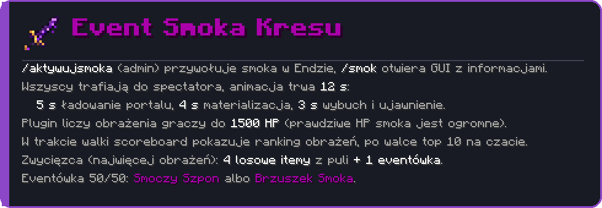

**Nagranie z serwera testowego** ([MP4](media/clips/smok-kresu.mp4)): tytuły „Smok Kresu” i „Smok się przebudza…”, błyski, pasek smoka i start walki z tytułem „WALKA!”.

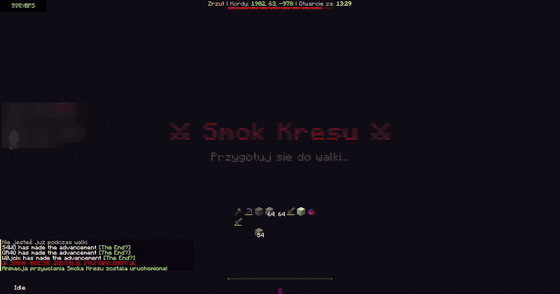

`/aktywujsmoka` uruchamia event w świecie Endu. Prawdziwe zdrowie smoka w Minecrafcie jest bardzo wysokie, żeby nie padł przypadkiem, a plugin sam liczy obrażenia graczy do progu **1500 HP** i wtedy zabija smoka ręcznie. W trakcie walki działa scoreboard z rankingiem obrażeń.

Po walce na czacie jest ranking top 10, a zwycięzca (najwięcej obrażeń) dostaje **4 losowe przedmioty z puli i jedną eventówkę**. Pula to m.in. diamentowa zbroja, netherite spear, 16 kryształów endu, 4–8 zaklętych złotych jabłek, mace, 16–32 złotych jabłek i 16 respawn anchorów. Eventówka to 50/50 [Smoczy Szpon](ITEMY.md#smoczy-szpon) albo [Brzuszek Smoka](ITEMY.md#brzuszek-smoka).

---

## Władca Lochów i drop

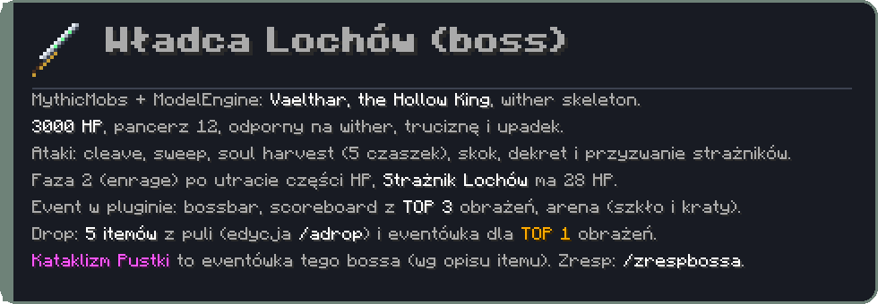

Boss jest zrobiony w MythicMobs z modelem z ModelEngine (pliki w repo roboczym: `HollowKingMobs.yml`, `HollowKingSkills.yml`). Plugin dodaje wokół niego event: bossbar, scoreboard z TOP 3 obrażeń, arenę (czerwone szkło i kraty, które po śmierci bossa zmieniają się i wracają po `restore-seconds`, domyślnie 600 s) oraz drop. Integracja z MythicMobs jest opcjonalna (`softdepend`), a konfigurację bossa widać w `bosses:` w `config.yml`. Same pliki MythicMobs i ModelEngine są osobno, nie ma ich w tym repo.

```yaml
bosses:
  hollowknight:
    mythic-id: HollowKing
    display-name: "Władca lochów"
    health: 3000
    drop-source: wladca_lochow
    drop-pool-size: 5
```

Mam jeszcze konfiguracje i modele dwóch kolejnych bossów (Sporefang i Storm Herald), ale pełny event w pluginie (scoreboard i drop z `/adrop`) ma na razie tylko Władca Lochów. Tak mówi komentarz w `config.yml`.

**Nagranie** ([MP4](media/clips/drop-gui.mp4)): okno `/drop` z podpowiedziami dla poszczególnych bossów.

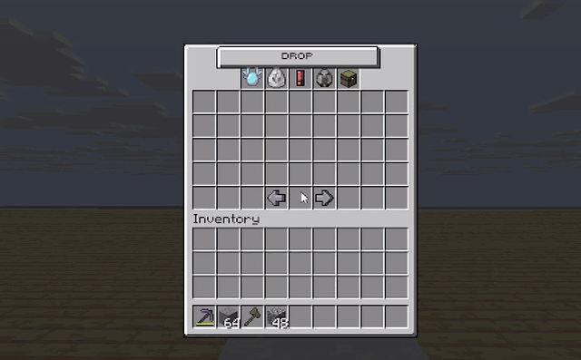

`/drop` pokazuje pule dropu **Władcy Endu**, **Jednogłowego Cerbera** i **Władcy Lochów** oraz zrzutu. Zwykły drop to losowe przedmioty z puli, a eventówkę dostaje tylko gracz z największymi obrażeniami (TOP 1). Dwa warianty w jednym slocie to 50/50, a w `/drop` taka para miga co sekundę. Pulę edytuje admin przez `/adrop`.

---

## Sklep i rynek

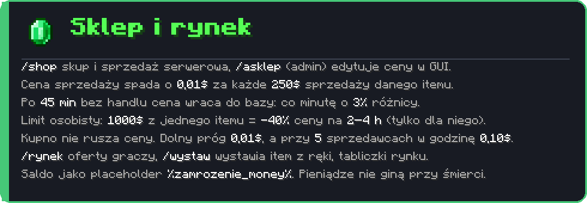

Parametry ekonomii z `config.yml` (`shop-market`, `shop-flood`):

| Ustawienie | Wartość | Znaczenie |
|---|---|---|
| `drop-per-money` / `drop-amount` | 250 / 0,01 | za każde 250$ sprzedaży cena spada o 0,01$ |
| `min-price` | 0,01 | dolna granica ceny |
| `busy-min-price` | 0,10 | dolna granica, gdy sprzedaje wielu (`busy-unique-sellers` = 5 w ciągu `busy-window-minutes` = 60) |
| `max-percent` | 130 | górna granica ceny: 130% ceny bazowej |
| `idle-minutes` / `recover-percent-per-minute` | 45 / 3 | po 45 min bez handlu cena co minutę zbliża się do bazy o 3% różnicy |
| `shop-flood.threshold` | 1000 | zarobek z jednego itemu, po którym cena spada **tylko jemu** |
| `shop-flood.discount-percent` | 40 | o ile spada |
| `shop-flood.min-hours` / `max-hours` | 2 / 4 | na jak długo (losowo) |

Moduły `shop` i `sell` można wyłączyć w `Modules`. Ceny bazowe edytuje admin w GUI (`/asklep`).

**Rynek graczy:** `/rynek` pokazuje oferty z kategoriami i sortowaniem, `/wystaw` wystawia przedmiot z ręki (cena wpisywana na czacie), a `MarketSignListener` obsługuje tabliczki. Zakup idzie przez okno potwierdzenia.

**Nagranie** ([MP4](media/clips/rynek-gui.mp4)): okno `/rynek` z kategoriami, filtrowaniem i wyszukiwaniem.

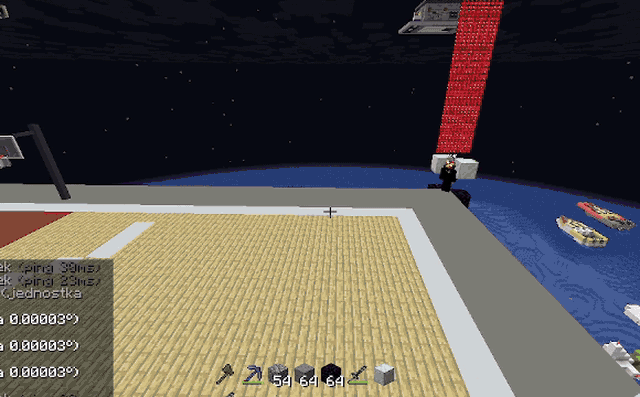

Okna mają własne tła z paczki zasobów:

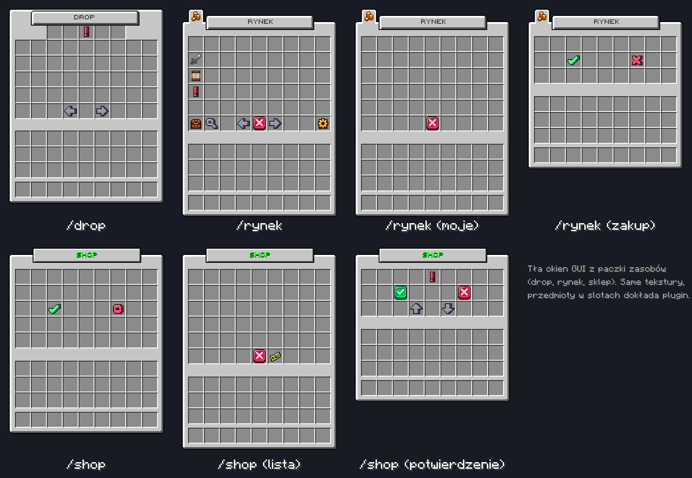

---

## Klany

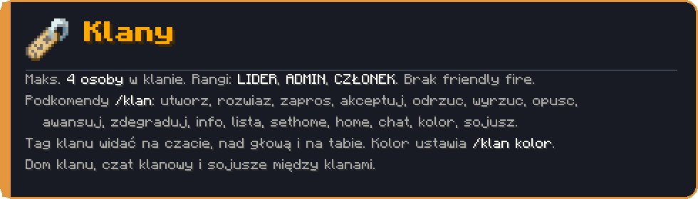

Osobny podsystem w pakiecie `pl.zamrozenie.clans` (komendy, listenery, managery, modele). Dane klanów trzymane są w `DataManager`, a tagi klanu aktualizują się od razu na czacie, nad głową i w tabie. Klany nie biją się nawzajem (`CombatListener`), a sojusze działają przez `AllianceManager`.

---

## Walka, antylogout i zasady PvP

* **Tag walki** (`combat-tag.duration-seconds: 30`): PvP nakłada 30 s tagu. W tagu większość komend jest zablokowana, a ender chest i shulkery nie działają. **Wylog w tagu = śmierć** (drop przedmiotów, XP i utrata serca).
* **Perły endu są wyłączone** (`PearlRulesListener` kasuje je z ekwipunku, ziemi, skrzyń i rzutów), ale ustawienia cooldownu zostały w configu na wypadek powrotu. Riptide w walce ma cooldown 20 s.
* **Limity przedmiotów** (`item-limits`): max 3 totemy i 8 pereł w ekwipunku, nadmiaru nie da się podnieść ani wyjąć ze skrzyni.
* **Kryształy endu** nie da się craftować ani stawiać, TNT w minecarcie robi o 20% mniej obrażeń.
* **Mace**: nie można go zaklinać, a po trafieniu ma cooldown 45 s. **Spear**: 20 s po obrażeniach, a Lunge znika na 15 s (wraca tylko, jeśli gracz dalej ma włócznię).
* **Nether**: ancient debris znika z chunków (`netherite.strip-nether`), w skrzyniach nie spawnują się scrap, sztabki, szablony i gear, a łóżek w Netherze nie da się stawiać ani wysadzać. Wejście do Netheru można zamknąć dla graczy (`nether-access.lock-players`, uprawnienie `zamrozenie.nether`).

---

## AntiCheat i anti-xray

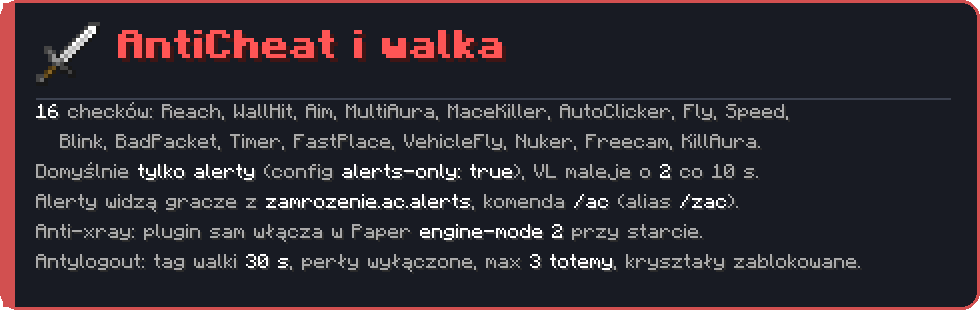

Własny anticheat w pakiecie `pl.zamrozenie.anticheat`: `MovementChecks`, `CombatChecks`, `WorldChecks`, `BehaviorAnalyzer` (analiza rotacji i celowania) i `PlayerData` z poziomami naruszeń (VL). W configu jest przełącznik `alerts-only`, a komentarz przy nim mówi, że nic nie blokuje (setback i kick są wyłączone w kodzie). Przy starcie plugin sprawdza `paper-world-defaults.yml` i włącza anti-xray z `engine-mode: 2`, jeśli był wyłączony (po zmianie potrzebny jest restart).

Komenda `/ac` pokazuje alerty i VL graczy.

---

## Drobne systemy

**Nagranie `/zamrozenie 10m`** ([MP4](media/clips/zamrozenie.mp4)): tytuł „Zamrożenie!” z odliczaniem, a świat i gracze stoją w miejscu.

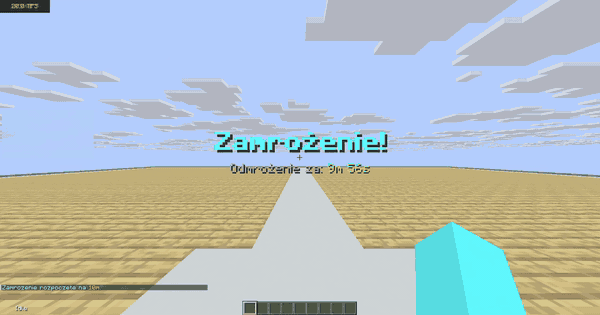

| Co | Opis |
|---|---|
| `/zamrozenie <czas>` | tytułowa funkcja: zamraża moby (AI off) i graczy (ruch, komendy, bloki, interakcje, wyrzucanie i podnoszenie) na czas do 24 h (`60s`, `5m`, `1h30m`), tytuł z odliczaniem, `/zamrozenie stop` kończy |
| `/home` | **2 sloty** domów, GUI i odliczanie przed teleportem (`home-cooldown-seconds: 5`) |
| `/tpa`, `/tpaccept`, `/tpadeny` | prośby o teleport wygasają po 60 s |
| `/topki` | GUI z topkami: siano (pieniądze), zabójstwa, śmierci. Przy pierwszym starcie statystyki są liczone z logów serwera |
| `/tutorial` (`/poradnik`) | poradnik w GUI z opisem zasad serwera |
| Locator bar | pasek lokatora (1.21.6+) widoczny w promieniu 100 kratek, dynia, głowa ani skradanie go nie ukrywają |
| PlaceholderAPI | `%zamrozenie_money%` |
| `/wysrodkuj` | pomocnik do eventów: szuka bezpiecznego środka kręgu dla N graczy |
| Chowanie komend | `/plugins`, `/pl`, `/ver` są ukryte bez uprawnienia `zamrozenie.seeplugins` |
| Handel | farmer nie sprzedaje placka z dyni (trade jest podmieniany) |
